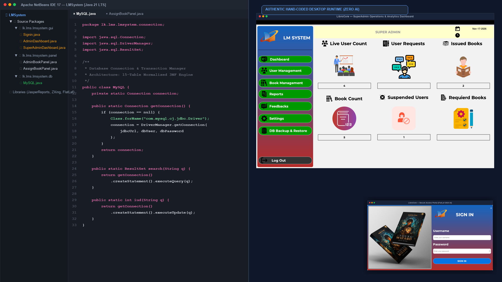
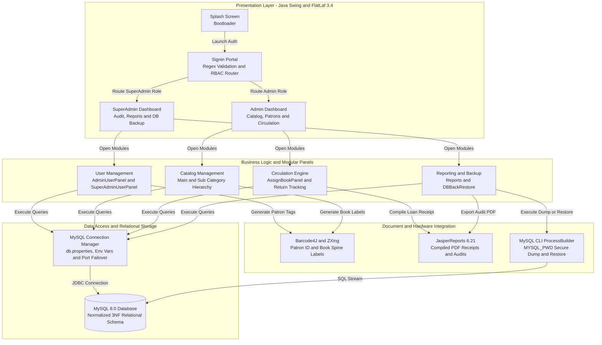
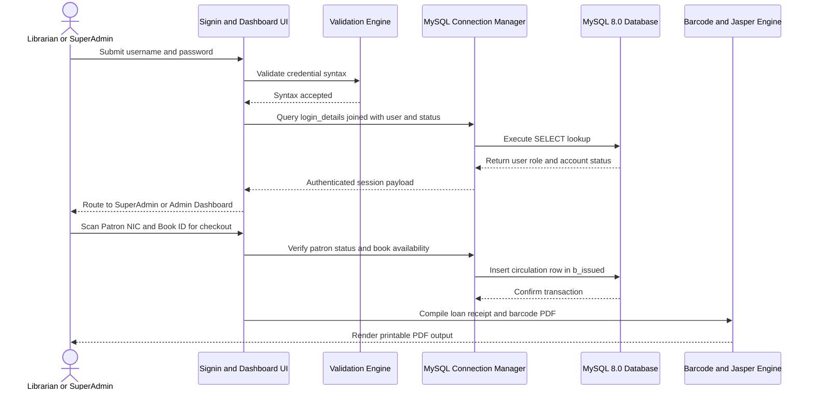
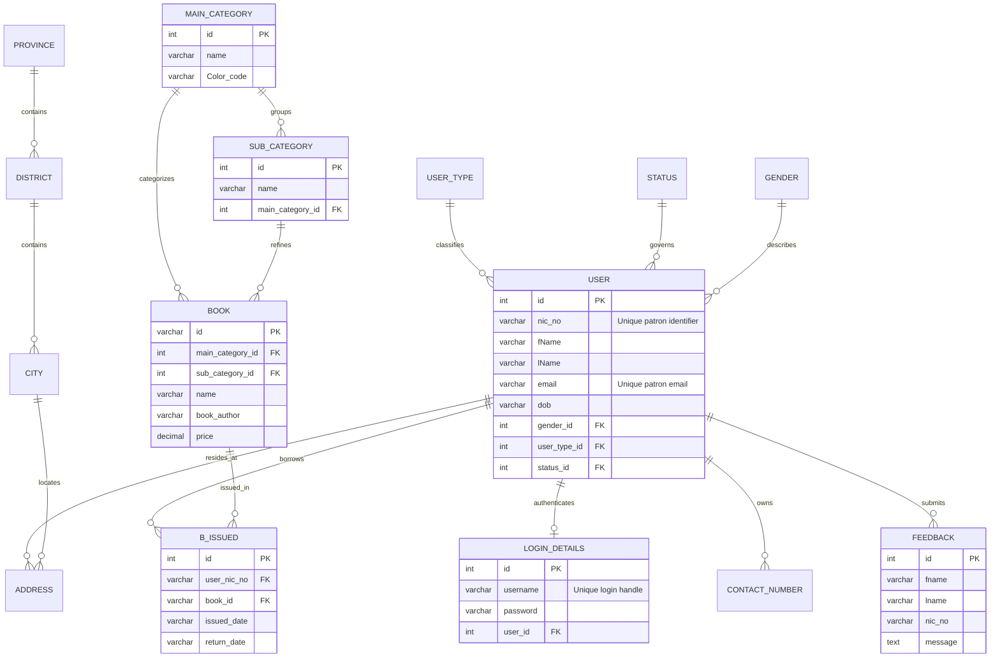
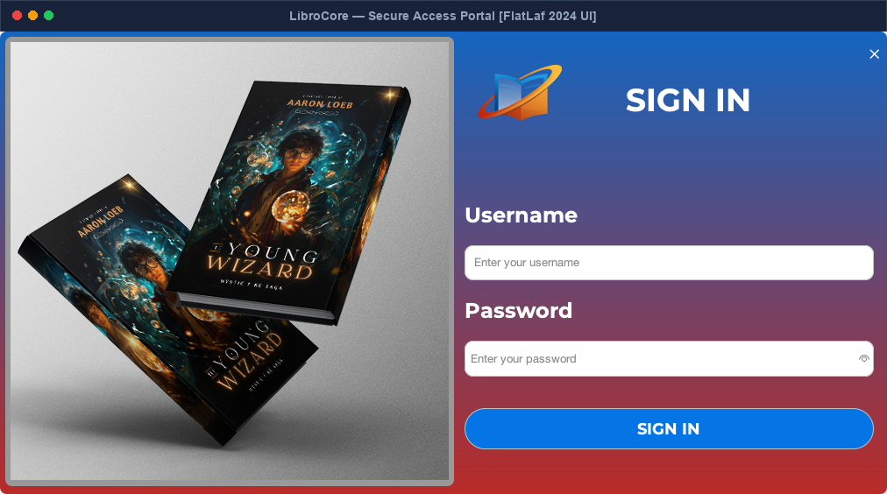
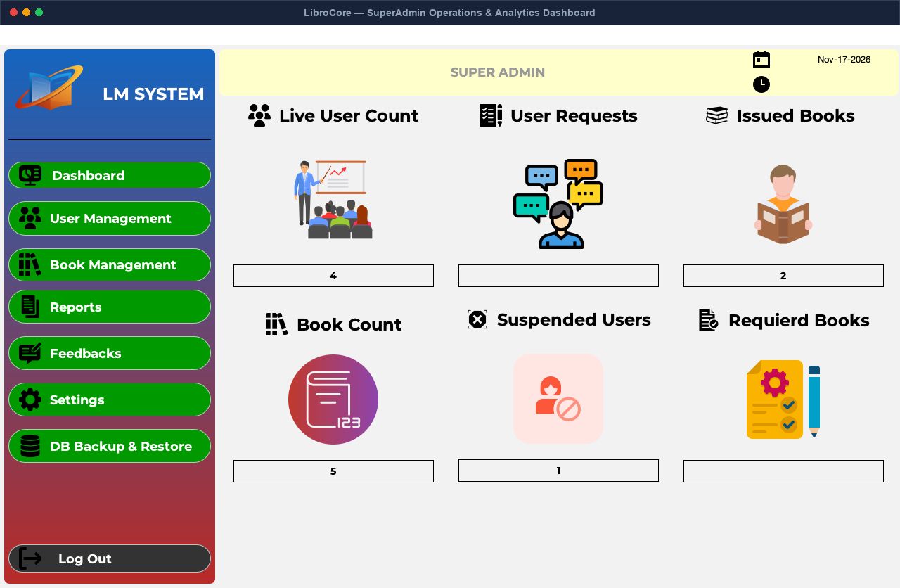
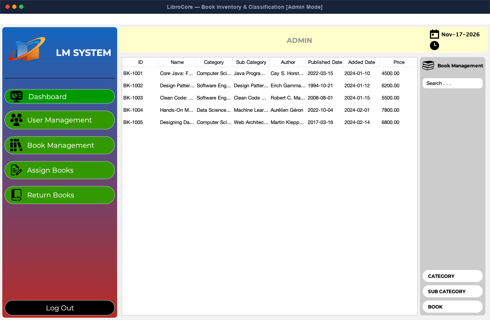
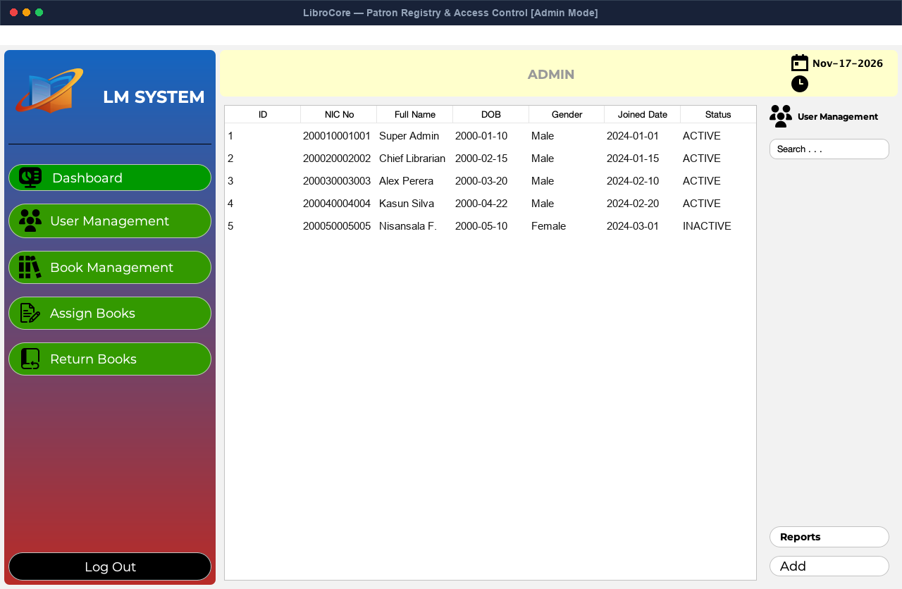
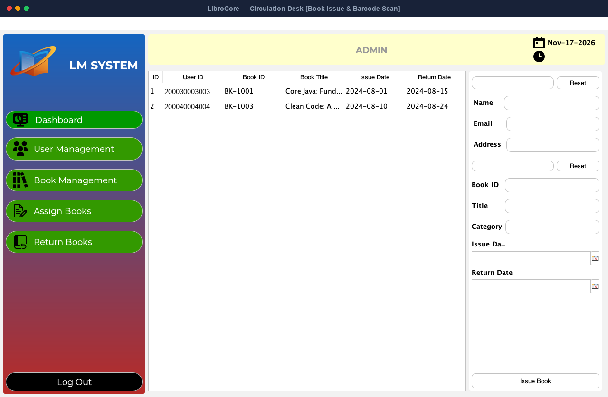
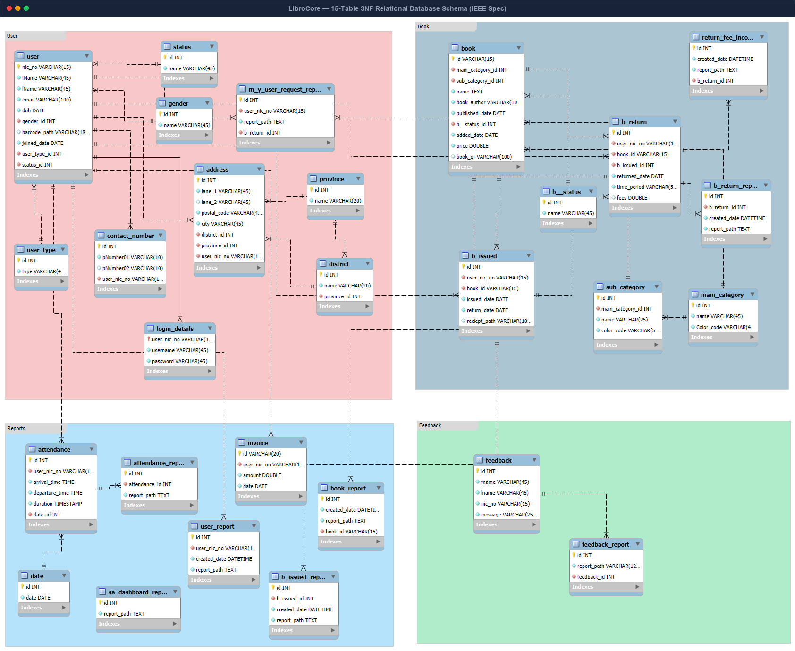

<div align="center">

# 📚 LibroCore — Enterprise Desktop Library Management System

[](https://openjdk.org/)
[](https://www.mysql.com/)
[](https://netbeans.apache.org/)
[](https://www.formdev.com/flatlaf/)
[](https://community.jaspersoft.com/)
[](LICENSE)

<br/>

**An enterprise-architected Java Swing desktop Library Information & Circulation System.**<br/>
Engineered with a **3NF MySQL relational schema**, **Barcode4J / ZXing scanning**, **JasperReports PDF compilation**, and a modern **FlatLaf desktop design system**.

<br/>



</div>

---

## 🌟 Executive Summary

**LibroCore** replaces manual paper register workflows with an automated, role-governed desktop library management platform. Engineered from first principles in Java Swing and MySQL 8.0, it orchestrates the full institutional library lifecycle: patron registration, cascading geographic jurisdictions, two-tier catalog classification, dynamic barcode/QR label printing, circulation tracking, overdue penalty calculation, and automated database backup/restore.

Also includes a 6-slide visual case study carousel ([LibroCore_LMS_LinkedIn_Carousel.pdf](assets/LibroCore_LMS_LinkedIn_Carousel.pdf)).

---

## 🏛️ System Architecture

### Layered Desktop Runtime Architecture



### Authentication & Circulation Flow



### Core 3NF Relational Schema



---

## 📸 Interactive UI Showcase

Every interface is built natively in Java Swing with custom anti-aliased Java2D components, FlatLaf styling, and Event Dispatch Thread (EDT) safe timers.

| Modern Authentication Portal | SuperAdmin Operations Dashboard |
| :---: | :---: |
|  |  |
| *Enter-key navigation, password reveal toggle & gradient card* | *Real-time library counters, live clock & privileges rail* |

| Book Inventory & Classification | Patron Registry & Access Control |
| :---: | :---: |
|  |  |
| *Keystroke search filters & normalized category trees* | *Synthetic demo registry with instant status filtering* |

| Circulation & Loan Issue Desk | Return Desk & Normalized 3NF Schema |
| :---: | :---: |
|  |  |
| *Dual-entity verification (Patron ID + Book ID) & date pickers* | *Multi-layer normalized 3NF relational entity design* |

---

## 🚀 Key Engineering Capabilities

- **Dual-Tier Role-Based Access Control (RBAC):** Distinct operational workspaces for `SUPERADMIN` and `ADMIN` roles with account state enforcement (`ACTIVE`, `INACTIVE`, `PENDING`) and centralized regex input validation (`Validation.java`).
- **Normalized Catalog & Geographic Cascades:** Hierarchical `main_category -> sub_category -> book` catalog indexing and `province -> district -> city -> address` patron location modeling in strict 3NF.
- **Hardware Barcode & QR Label Export:** Dynamic 1D barcode and 2D QR code PDF compilation using **Barcode4J** and **ZXing** for patron cards and book inventory tags.
- **Enterprise PDF Reporting:** Integrated **JasperReports 6.21** templates (`src/reports/*.jasper`) powered by OpenPDF/iText for printable receipts, attendance logs, and audit statements.
- **Externalized Secret & Connection Management:** Zero hardcoded credentials in source code — `MySQL.java` and `DBBackRestore.java` load configuration from `db.properties`, JVM properties, or environment variables (`DB_HOST`, `DB_PORT`, `DB_NAME`, `DB_USER`, `DB_PASSWORD`), with smart port failover (`3307 <-> 3306`) and secure `MYSQL_PWD` subprocess backup/restore.
- **EDT-Safe FlatLaf UI:** High-DPI FlatLaf 3.4 theme with custom rounded Java2D controls (`RoundButton`, `RoundTextfield`, `RoundPasswordField`) and non-blocking 1-second timer updates.

---

## 🛠️ Tech Stack

| Component | Technology | Version | Role |
| :--- | :--- | :--- | :--- |
| **Language** | Java (JDK) | **21 LTS / 17+** | Core desktop application & business logic |
| **GUI Framework** | Java Swing + FlatLaf | **3.4.1** | Modern desktop presentation layer |
| **Database** | MySQL Server | **8.0+** | Normalized 3NF relational persistence |
| **JDBC Driver** | MySQL Connector/J | **8.4.0** | Type-4 database connectivity |
| **Reporting** | JasperReports + OpenPDF | **6.21.3 / 1.3.30** | Printable PDF reports & barcode sheets |
| **Barcodes / QR** | Barcode4J + ZXing | **3.4.1** | 1D/2D barcode generation & rendering |
| **Vector Graphics** | Apache Batik | **1.17** | SVG rendering for reports and labels |

---

## 📁 Repository Structure

```text
LMSystemNew/
├── assets/
│   ├── LibroCore_LMS_LinkedIn_Carousel.pdf   # 6-slide visual case study deck
│   ├── linkedin_cover_hero.png               # Portfolio cover artwork
│   └── portfolio_screenshots/                # Framed UI & schema screenshots
├── database/
│   └── schema.sql                            # 3NF MySQL schema & synthetic demo seed data
├── lib/                                      # Runtime JAR dependencies (FlatLaf, JasperReports, JDBC)
├── nbproject/                                # Apache NetBeans Ant project metadata
├── scripts/
│   ├── generate_all_slides_clean.py          # Carousel slide deck generator
│   └── generate_portfolio_suite.py           # Framed screenshot & IDE composite generator
├── src/
│   ├── bookqrcodes/                          # Runtime output folder for generated book QR PDFs
│   ├── userqrcodes/                          # Runtime output folder for generated patron QR PDFs
│   ├── reports/                              # Compiled JasperReports (.jasper) templates
│   └── lk/lms/lmsystem/
│       ├── component/                        # Custom Java2D rounded UI components
│       ├── connection/MySQL.java             # Externalized JDBC manager with port failover
│       ├── dialog/                           # Modal CRUD forms (Users, Books, Categories, Feedback)
│       ├── gui/                              # Splash, Signin, AdminDashboard, SuperAdminDashboard
│       ├── model/                            # Domain enums (Status, UserType)
│       ├── panel/                            # Modular views (Dashboard, Catalog, Circulation, Backup)
│       └── validation/                       # Centralized regex validation rules
├── test/                                     # Database smoke test & UI capture harnesses
├── db.properties.example                     # Safe database configuration template
├── run.sh                                    # Local launcher script
├── start_db.sh                               # Isolated local MySQL bootstrapper
├── LICENSE                                   # MIT License
└── README.md
```

---

## ⚡ Local Setup & Execution

### Prerequisites
1. **Java JDK 17 or 21 LTS** (`java -version`, `javac -version`)
2. **MySQL Server 8.0+** (installed locally or available on `PATH`)

### 1. Clone & Configure Environment
```bash
git clone https://github.com/theekshana-sudeepa/LMSystemNew.git
cd LMSystemNew
cp db.properties.example db.properties
```

Edit `db.properties` with your local MySQL credentials (never commit `db.properties`):
```properties
db.host=127.0.0.1
db.port=3307
db.name=library_dbdb
db.user=root
db.password=your_local_password
```

Alternatively, configure via environment variables (`DB_HOST`, `DB_PORT`, `DB_NAME`, `DB_USER`, `DB_PASSWORD`, and optional `MYSQL_BIN_DIR` for in-app backup/restore).

### 2. Import Schema & Build
```bash
# Option A: Import into an existing MySQL instance
mysql -u root -p < database/schema.sql

# Compile sources
mkdir -p build/classes
javac -encoding UTF-8 -d build/classes -cp "lib/*" $(find src -name "*.java")
cp -r src/lk/lms/lmsystem/icon src/lk/lms/lmsystem/img build/classes/lk/lms/lmsystem/
cp -r src/reports build/classes/

# Launch desktop application
java -cp "build/classes:lib/*:." lk.lms.lmsystem.gui.Splash
```

Or use the macOS/Linux one-click local bootstrapper (after setting `db.properties`):
```bash
chmod +x run.sh start_db.sh
./run.sh
```

### Synthetic Demo Login Credentials (from `database/schema.sql`)

| Role | Username | Demo Password | Access Scope |
| :--- | :--- | :--- | :--- |
| **Super Administrator** | `superadmin` | `SuperAdmin@123` | Full audit dashboard, staff/patron CRUD, reports & DB backup |
| **Librarian / Staff** | `admin` | `Admin@123` | Catalog management, patron registry & book circulation |

> **Security Note:** The accounts above are synthetic local demo records seeded by `database/schema.sql`. Rotate credentials and enforce hashed password storage (e.g. BCrypt/Argon2) before any non-local deployment.

---

## 📄 License

Distributed under the **MIT License**. See [LICENSE](LICENSE) for full terms.

---

<div align="center">

Engineered by **Theekshana Sudeepa**<br/>
[LinkedIn](https://www.linkedin.com/in/theekshana-sudeepa/) · [GitHub](https://github.com/theekshana-sudeepa) · [LexoraTech](https://lexoratech.com)

</div>
